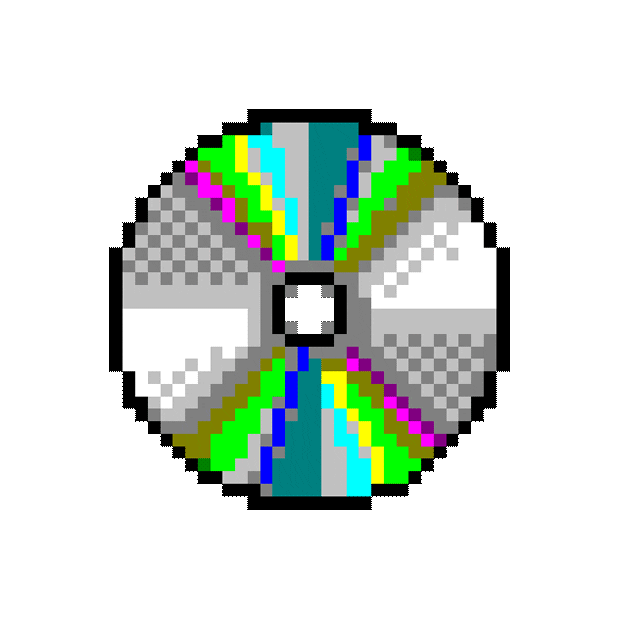
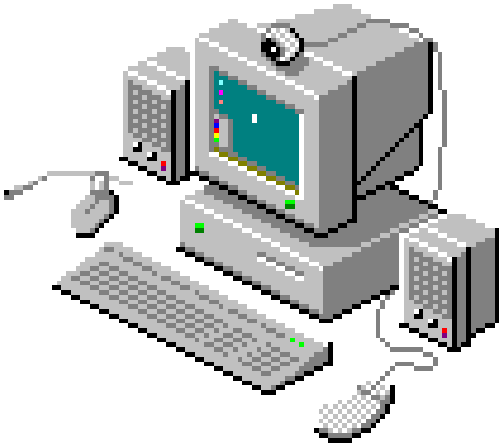

  <h1>
    
      <bold>WELCOME TO SABUWU'S GITHUB PAGE!</bold>
    
  </h1>

 

  <h1> <bold> 👾  ABOUT ME </bold> </h1>
  
I am <strong>sabu</strong>, a programmer and DevOps engineer with diverse skills spanning across low and high-level languages, AI/ML, IoT architectures, OpSec, and much more!!!

 

  <h1>🛠️  TECH STACK & SKILLS</h1>
   

  <!-- Python -->
  
  <!-- Go -->
  
  <!-- C / C++ -->
  
  
  <!-- Rust -->
  
  <!-- Lua -->
  
  <!-- C# -->
  
  
    
  
  <!-- Web & Infra -->
  
  
  

 

 

    
  > Your dream doesn't end here <

